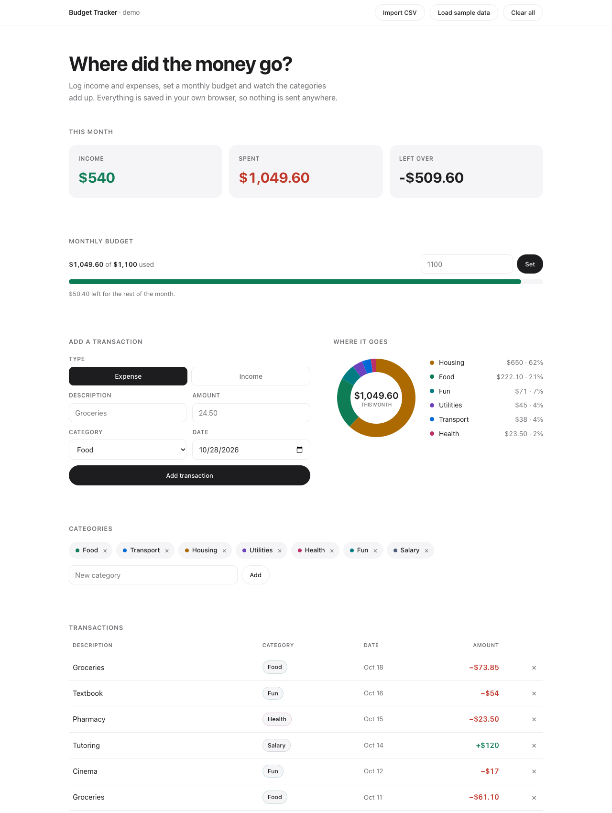

# Budget Tracker

A single page budget tracker. Log income and expenses, set a monthly budget, and see
where the money actually goes.

**Live demo → [budget-tracker-rajveer.vercel.app](https://budget-tracker-rajveer.vercel.app)**



## What it does

- **Transactions** — add income or expenses with a description, amount, category and date
- **Monthly budget** — set a budget and track how much of it is spent, with a bar that turns
  red once you go over
- **Category breakdown** — a donut chart of this month's spending, drawn directly on a
  `<canvas>` with no charting library
- **Custom categories** — add or remove your own
- **CSV import** — drop in a bank statement export and it populates the dashboard
- **Sample data** — loads automatically on a first visit so the page is never empty

## Importing a bank statement

Bank exports do not agree on much, so columns are matched by header name rather than
position. The importer handles:

| Variation | Example |
| --- | --- |
| A single signed amount column | `Amount` with `-82.40` for spending |
| Separate debit and credit columns | `Debit` / `Credit` |
| Parenthesised negatives | `(1250.00)` |
| Several date formats | `2026-10-02`, `10/02/2026`, `4 Oct 2026`, `Oct 4, 2026` |
| Quoted fields containing commas | `"COMCAST CABLE, INC"` |
| An Excel byte-order mark | stripped before parsing |

If the file has no category column, categories are guessed from the description with a
keyword table, so `WHOLEFDS MKT #123` lands in Food and `SHELL OIL 4411` in Transport.

Nothing is committed until you accept the preview, which shows the detected column mapping,
a sample of the parsed rows and a count of anything skipped. Income and expense are inferred
from the sign of the amount, and because some banks sign the other way there is a single
button to flip them.

The file is read in the browser with `FileReader`. It is never uploaded.

Everything persists to `localStorage`, so your data survives a refresh and never leaves
your browser.

## Running it

There is no build step and no dependencies. Open the file:

```bash
open index.html
```

Or serve it locally:

```bash
python3 -m http.server 8000
```

## Notes on the build

The whole app is one `index.html` — markup, styles and logic. For something this size that
keeps it easy to read and trivial to deploy anywhere that serves static files.

A few decisions worth calling out:

- **No accounts.** An earlier version of this project had a login screen that stored
  passwords in `localStorage` in plain text and could be skipped by navigating straight to
  the main page. That is worse than no authentication at all, because it implies a security
  guarantee it cannot keep. It was removed rather than patched. Real accounts need a server,
  hashed passwords and sessions, which is a different project.
- **Reads from storage are defensive.** `localStorage` throws in some private browsing
  modes and can return corrupt JSON, so every read is wrapped and falls back to empty state.
- **The chart is hand drawn.** Arc strokes on a canvas, scaled to `devicePixelRatio` so it
  stays sharp on retina displays. Pulling in a charting library for one donut was not worth
  the weight.

## Origin

This started as my IB Computer Science internal assessment — a finance tracker built for a
university student tracking expenses on paper. That version was a Flask backend that only
stored category names, a table that lost every row on refresh, and the fake login described
above. This is a rewrite that keeps the original idea and makes it actually work.

## License

MIT
